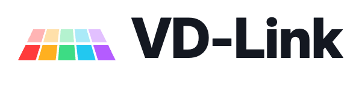
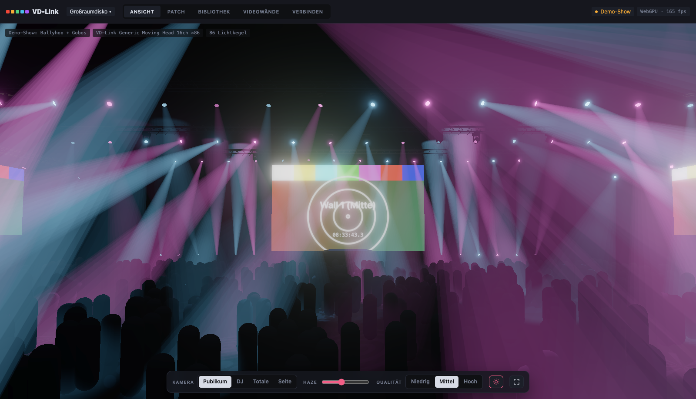
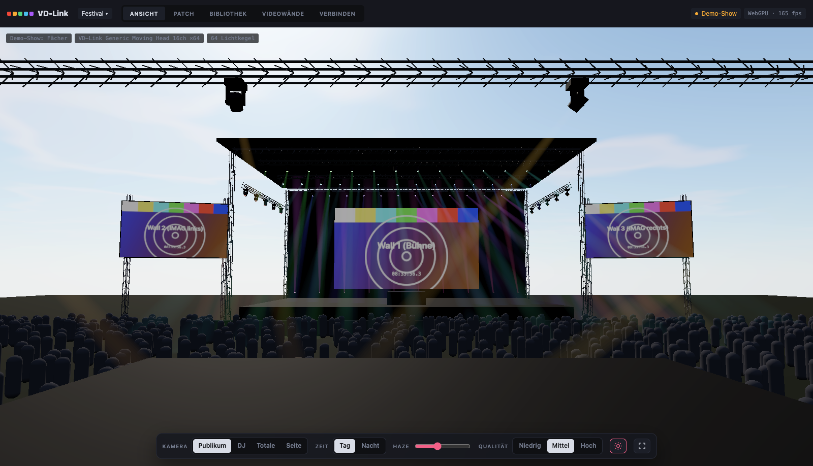

<h1 align="center">
  <picture>
    <source media="(prefers-color-scheme: dark)" srcset="assets/logo-for-dark.png">
    
  </picture>
</h1>

3D-Lichtvisualisierer für Art-Net und sACN. Dein Lichtpult steuert eine virtuelle Location – Club, Großraumdisko oder Festival – und du siehst die Show, bevor sie hängt. Schwesterprojekt von [VJ-Link](https://skyplayser.github.io/VJ-LINK/) und [LJ-Link](https://github.com/skyplayser/LJ-Link). „VD“ steht für **Virtual-Demo**.

> Stand: **Beta 0.1.0**. Läuft auf macOS (Apple Silicon) und ist für Windows 10/11 vorbereitet; vieles hat noch keine echte Bühnentechnik gesehen.



| | |
|---|---|
|  |  |
|  |  |

## Was schon läuft

| Bereich | Stand |
|---|---|
| Ansicht | WebGPU (Rückfall WebGL2): Moving Heads mit Lichtkegeln im Haze, Gobos auf Boden, Wänden und Publikum, Prisma, Zoom, Strobe, Farbe, Glühen. Kameras Publikum, DJ, Totale, Seite, frei drehbar. Qualität Niedrig/Mittel/Hoch |
| Szenarien | **Club** (eine Videowand hinter dem DJ, 50 Köpfe), **Großraumdisko** (drei Videowände, 86 Köpfe), **Festival** (Bühne mit Dach, IMAG-Wände, Delay-Tower, Tag/Nacht, 64 Köpfe) |
| Pult | Art-Net 4 mit ArtPoll (Pulte finden VD-Link als Node) und sACN (Multicast, Unicast, Priorität). Mehrere Quellen werden zusammengeführt (höchste Priorität, sonst HTP). Universe-Zählung einstellbar. Getestet mit eigenem Testsender |
| Bibliothek | Über 6.000 Geräte: aus der [Open Fixture Library](https://open-fixture-library.org) (MIT) und von [QLC+](https://www.qlcplus.org) (Apache-2.0) sowie rund 3.800 eigene Definitionen nach Herstellerangaben (EPL-2.0, Liste in [`docs/FIXTURES-VD.md`](docs/FIXTURES-VD.md)), auch UKing, YUER, Betopper, Shehds, Lixada. Kombinierte China-Kanäle („Aus / Dimmer / Strobe / Offen“) werden verstanden |
| Patch | Automatisch, lückenlos ab Universe 1, mit Live-Farbe je Gerät. Patchliste als CSV für Daslight, MA, QLC+ |
| Videowände | Jede Wand kann ein **virtueller Monitor** sein (macOS): VJ-Link gibt im Vollbild darauf aus, VD-Link zeigt das Bild auf der Wand. Sonst Testbild oder ein echter Bildschirm |
| Baukasten | **Location-Builder**: Clubs und Festivals grob nachbauen (Raum/Gelände, Einrichtung, Traversen, Videowände, Lampen, Publikum) und als `.vdloc` speichern. **Fixture-Builder**: fehlende Lampen selbst anlegen (`.vdfix`). Projekte (`.vdlink`) enthalten Location und eigene Lampen |
| Demo-Show | Ohne Pult läuft eine Demo-Show (Fächer, Ballyhoo mit Gobos, Strobe-Hit, Prisma-Welle) – über denselben DMX-Weg wie ein Pult |
| Oberfläche | Startbildschirm wie VJ-Link (vor der 3D-Ansicht), Projektdateien `.vdlink` mit „Zuletzt geöffnet“, Einstellungen, Tabs ANSICHT, PATCH, BIBLIOTHEK, VIDEOWÄNDE, VERBINDEN, Deutsch und Englisch |
| grandMA2 | Assistent für MA auf einem zweiten Rechner oder MA2 onPC auf demselben Windows-Rechner, mit Live-Prüfung (ArtPoll, ankommende Universes) und Befehlszeile. MA2 onPC braucht MA-Hardware (Wing/Node), damit es Art-Net/sACN ausgibt |

## Noch offen

Eigener 3D-Editor für Szenarien, Fixture-Editor, weitere Gerätetypen (PAR, Bars/Pixel, Strobe, Blinder, Laser), virtuelle Monitore unter Windows ([Virtual-Display-Driver](https://github.com/VirtualDrivers/Virtual-Display-Driver), MIT), Syphon/Spout, Anbindung an LJ-Link (LJ-Link führt, VD-Link folgt – in Abstimmung), MVR/GDTF-Import, Signierung. Messungen auf MacBook Pro M2 und Gaming-Laptops ab 2018 stehen aus. Konzept: [`docs/KONZEPT.md`](docs/KONZEPT.md), Messwerte: [`docs/SPIKE-ERGEBNIS.md`](docs/SPIKE-ERGEBNIS.md).

## Starten

Voraussetzung: Node.js 22 oder neuer.

```bash
npm install
npm run fixtures        # einmalig: Fixture-Bibliothek laden und umwandeln
npm run build:native    # nur macOS: Helfer für virtuelle Monitore
npm start
```

Entwickeln mit Hot-Reload: `npm run dev`. Prüfen: `npm run check`.

DMX ohne Pult testen:

```bash
npm run dmx-sender -- --proto artnet --target 127.0.0.1
npm run dmx-sender -- --proto sacn --scenario disco
```

Installer bauen: `npm run dist:mac` bzw. `npm run dist:win`. Ein Tag `v*` baut über GitHub Actions die Installer für macOS (Apple-Chip und Intel) und Windows und veröffentlicht sie als Release. Installieren: [`docs/INSTALLATION.md`](docs/INSTALLATION.md).

## Pult verbinden

1. Im Pult die Geräte so patchen, wie es VD-Link unter **PATCH** zeigt (oder die CSV-Liste nutzen).
2. Art-Net oder sACN an die IP-Adresse von VD-Link senden (steht auf dem Startbildschirm und unter **VERBINDEN**).
3. Pult und VD-Link auf demselben Rechner: sACN oder Art-Net-Unicast an `127.0.0.1`.
4. Falls die Universes verrutscht sind: unter **VERBINDEN** die Universe-Zählung anpassen (Art-Net zählt ab 0, sACN ab 1).

Videowand mit VJ-Link: **VIDEOWÄNDE → Virtuellen Monitor erzeugen**, in VJ-Link unter **AUSGABE** den Bildschirm „VD-Link Wall …“ wählen. macOS fragt beim ersten Mal nach der Freigabe „Bildschirmaufnahme“.

## Aufbau

```
electron/        Main-Prozess: Art-Net/sACN-Empfang, Merge, virtuelle Monitore, Fenster
src/shared/      Fixture-Format, DMX-Codec (DMX ↔ Look), Szenarien, Patch, Demo-Show
src/render/      Three.js/TSL: instanzierte Lichtkegel, Licht auf Flächen, Gobos, Videowände, Location
src/ui/          Startbildschirm, Tabs, Texte (DE/EN)
native/macos/    vd-display-helper: virtueller Monitor (CGVirtualDisplay)
tools/           Fixture-Import (OFL + QLC+), eigene Fixtures (`vd-fixtures/`, `research/`), DMX-Testsender
docs/            Konzept, Spike-Ergebnis, Screenshots
```

## Technik-Entscheidung

Electron mit TypeScript und Three.js (WebGPU mit Rückfall auf WebGL2, Shader in TSL). Gründe: nur Bausteine mit freizügigen Lizenzen, läuft auf macOS und Windows, gleiche Basis wie VJ-Link. Damit es auf Laptops flüssig bleibt, werden alle Lichtkegel in einem Draw-Call gezeichnet, Licht auf Flächen über einen eigenen Shader berechnet statt mit hunderten echten Lichtquellen, und der Haze kommt aus einer vorberechneten 3D-Rauschtextur.

## Sicherheit im Live-Betrieb

VD-Link zeigt nur an, es steuert nichts. Strobe-Effekte in der Vorschau können trotzdem schnell blitzen – Vorsicht bei fotosensitiver Epilepsie. Art-Net und sACN haben keine Anmeldung (Branchenstandard): Show-Netz und Gäste-WLAN trennen.

Der virtuelle Monitor unter macOS nutzt eine nicht öffentliche Schnittstelle von macOS (wie DeskPad und BetterDisplay). Sie funktioniert, kann sich aber mit macOS-Updates ändern.

## Lizenz

Eclipse Public License 2.0, siehe `LICENSE`. Drittanbieter-Bausteine und ihre Lizenzen: [`THIRD_PARTY.md`](THIRD_PARTY.md), Fixture-Daten: `public/fixtures/NOTICE.md` (wird von `npm run fixtures` erzeugt).

Art-Net™ Designed by and Copyright Artistic Licence Holdings Ltd. VD-Link ist ein unabhängiges Projekt und kein offizielles Produkt der genannten Hersteller; alle Marken gehören ihren Inhabern.
