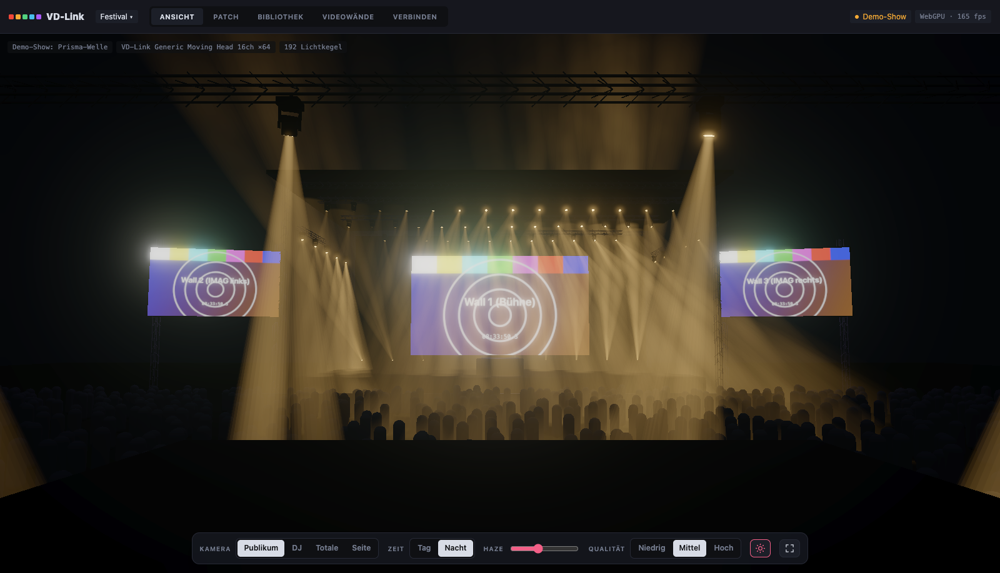
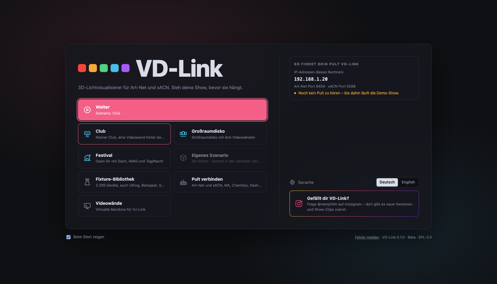
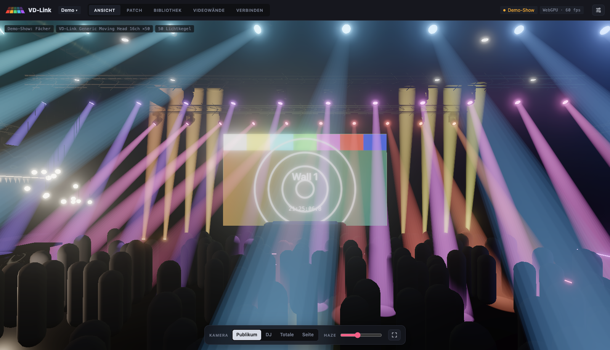
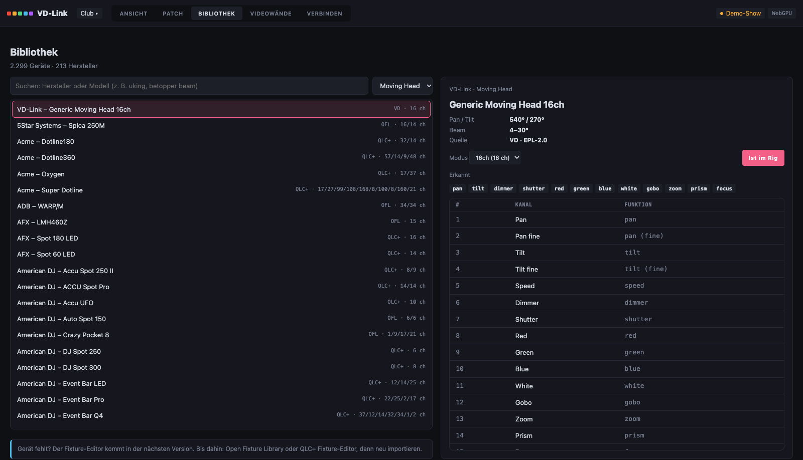
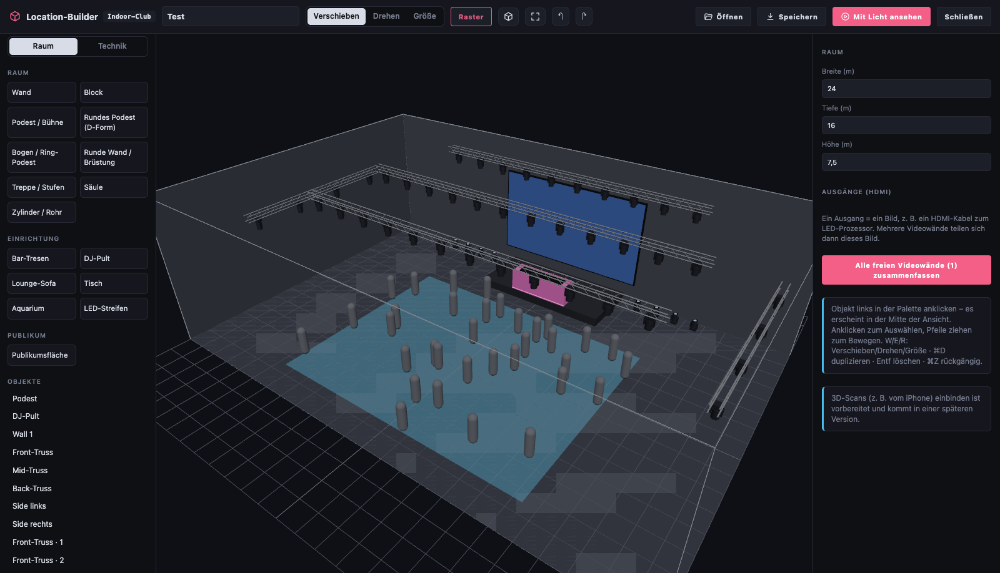
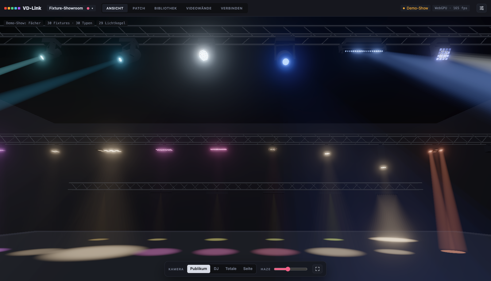
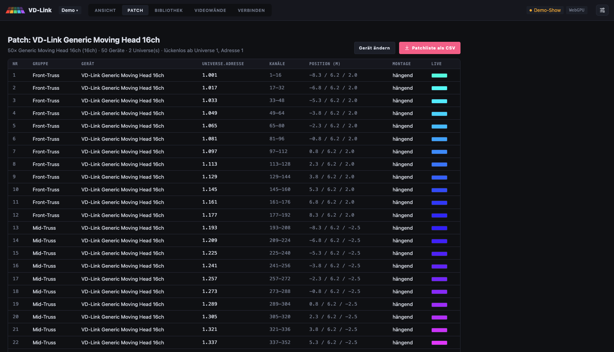
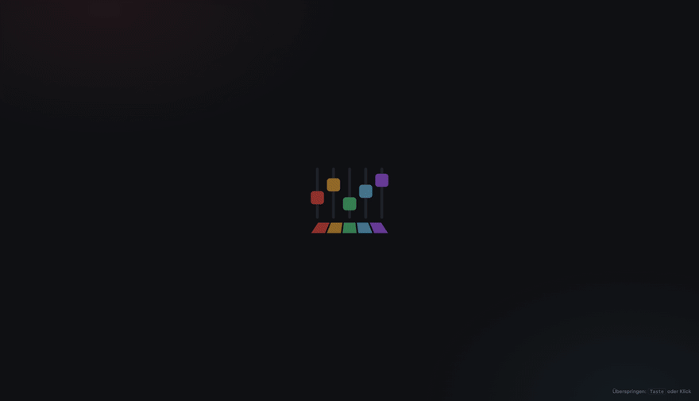

<p align="center">
  <picture>
    <source media="(prefers-color-scheme: dark)" srcset="docs/brand/vd-logo-dark.svg">
    
  </picture>
</p>

<h3 align="center">Sieh deine Lichtshow, bevor sie hängt.</h3>

<p align="center">
  Freier 3D-Lichtvisualisierer für Art-Net und sACN. Dein Pult steuert eine virtuelle Location –<br>
  Club, Großraumdisko, Festival oder dein eigener Nachbau – mit Lichtkegeln, Gobos, Pixeln und Videowänden.
</p>

<p align="center">
  <a href="https://github.com/skyplayser/VD-Link/releases/latest"></a>
  <a href="https://github.com/skyplayser/VD-Link/releases"></a>
  
  <a href="LICENSE"></a>
</p>

<p align="center">
  <a href="https://github.com/skyplayser/Link-Suite/releases/latest/download/Link-Suite-macos-arm64.dmg"></a>
  <a href="https://github.com/skyplayser/Link-Suite/releases/latest/download/Link-Suite-macos-intel.dmg"></a>
  <a href="https://github.com/skyplayser/Link-Suite/releases/latest/download/Link-Suite-windows.exe"></a>
  <br><sub>VD-Link wird über den Launcher <a href="https://skyplayser.github.io/Link-Suite/">Link-Suite</a> installiert und aktualisiert – zusammen mit LJ-Link, VJ-Link und den anderen Programmen der Suite.</sub>
</p>

<p align="center">
  
</p>

> **Beta.** Entwickelt und getestet auf macOS mit Apple-Chip. Die Installer für Intel-Macs und Windows 10/11 werden mitgebaut, sind aber noch wenig getestet – und vieles hat noch keine echte Bühnentechnik gesehen. Rückmeldungen sind sehr willkommen.

---

## ✨ Was VD-Link kann

<table>
<tr>
<td width="50%" valign="top">

### 🎛️ Jedes Pult
Art-Net 4 mit ArtPoll – Pulte finden VD-Link als Node – und sACN mit Multicast, Unicast und Priorität. grandMA2/3, ChamSys, Avolites, Hog, Onyx, Eos, Daslight, QLC+ … Mehrere Quellen werden zusammengeführt. Ein Assistent führt Schritt für Schritt durch **grandMA2**.

</td>
<td width="50%" valign="top">

### 💡 Licht, das wie Licht aussieht
WebGPU mit Lichtkegeln im Haze, Gobos auf Boden, Wänden und Publikum, Prisma, Zoom, Strobe und Glühen. **Washer** sind breit und weich, **Beams** schmal und hart – automatisch aus den Gerätedaten erkannt. Auf 60 fps begrenzt, damit daneben noch Luft für VJ-Link bleibt.

</td>
</tr>
<tr>
<td valign="top">

### 📚 Über 6 000 Geräte
Aus der [Open Fixture Library](https://open-fixture-library.org) und von [QLC+](https://www.qlcplus.org), dazu rund **3 800 eigene Definitionen** – von Robe, Martin und Claypaky bis UKing, YUER, Betopper und Shehds. Nach Hersteller sortiert, mit **Live-3D-Vorschau** jeder Lampe.

</td>
<td valign="top">

### 🟥 Jedes Pixel einzeln
LED-Zellen, Linsen und Halo-Ringe leuchten einzeln – Pixel-Bars, Bee-Eyes, Blinder und Matrix-Moving-Heads wie der UKing ZQ06133 mit 36 RGB-Pixeln plus 36 Warmweiß-Linsen. Eigene 3D-Modelle je Bauform: Moving Head, Bar, PAR, Scanner, Derby, GigBar …

</td>
</tr>
<tr>
<td valign="top">

### 🏗️ Eigene Location bauen
Der **Location-Builder** baut Clubs und Festivals nach: Wände, Podeste, runde Bühnen, Traversen (auch Kreis und Bogen), Videowände, Publikum. Lampen per Drag &amp; Drop auf die Traverse ziehen – sie rasten ein. Speichern als `.vdloc`.

</td>
<td valign="top">

### 📺 Videowände mit VJ-Link
Jede Wand kann ein **virtueller Monitor** sein: [VJ-Link](https://skyplayser.github.io/VJ-LINK/) gibt im Vollbild darauf aus, VD-Link zeigt das Bild auf der Wand (macOS). Oder die Wand zeigt einen **NDI®-Stream**¹ aus dem Netzwerk (macOS und Windows, [Anleitung](docs/NDI.md)). Mehrere Wände teilen sich einen HDMI-Ausgang – wie echte LED-Prozessoren.

</td>
</tr>
<tr>
<td valign="top">

### 🧰 Fehlt eine Lampe?
Der **Fixture-Builder** legt sie an oder passt eine Bibliotheks-Lampe an: Modi, Kanäle, 16 bit, Bereiche, Vorlagen und DMX-Test mit Vorschau. Projekte (`.vdlink`) nehmen Location und eigene Lampen mit – sie laufen auf jedem Rechner.

</td>
<td valign="top">

### 🎉 Ohne Pult loslegen
Drei fertige Szenarien – **Club**, **Großraumdisko** und **Festival mit Tag/Nacht** – plus eine Demo-Show mit Fächer, Ballyhoo, Strobe-Hit und Prisma-Welle. Patch automatisch, Patchliste als CSV für MA, Daslight und QLC+.

</td>
</tr>
</table>

## 🎬 Bilder

<table>
<tr>
<td width="50%"><br><sub><b>Festival bei Nacht</b> – Bühne mit Dach, IMAG-Wände, Delay-Tower</sub></td>
<td width="50%"><br><sub><b>Festival bei Tag</b> – gleiche Show, Umschalter Tag/Nacht</sub></td>
</tr>
<tr>
<td><br><sub><b>Startbildschirm</b> – Projekte, Vorlagen, Builder und Einstellungen</sub></td>
<td><br><sub><b>Club</b> – eine Videowand hinter dem DJ</sub></td>
</tr>
<tr>
<td><br><sub><b>Bibliothek</b> – 6 084 Geräte von 221 Herstellern, Live-Vorschau</sub></td>
<td><br><sub><b>Location-Builder</b> – Raum und Technik getrennt bearbeiten</sub></td>
</tr>
<tr>
<td><br><sub><b>Fixture-Showroom</b> – Washer, Spots, Beams, Bars und Blinder nebeneinander</sub></td>
<td><br><sub><b>Patch</b> – automatisch, mit Live-Farbe je Gerät</sub></td>
</tr>
</table>

## 🚀 In drei Schritten zur Show

1. **Installieren** – den Launcher [Link-Suite](https://skyplayser.github.io/Link-Suite/) laden und dort VD-Link installieren. Ohne Pult läuft sofort eine Demo-Show.
2. **Patchen** – im Pult die Geräte so patchen, wie VD-Link sie unter **PATCH** zeigt (oder die CSV-Liste importieren).
3. **Senden** – Art-Net oder sACN an die IP-Adresse von VD-Link (steht auf dem Startbildschirm und unter **VERBINDEN**). Pult auf demselben Rechner: sACN oder Art-Net-Unicast an `127.0.0.1`.

<details>
<summary>Universes verrutscht? Videowand mit VJ-Link?</summary>

- **Universes:** Art-Net zählt ab 0, sACN ab 1 – unter **VERBINDEN** lässt sich die Zählung anpassen.
- **Videowand:** **VIDEOWÄNDE → Virtuellen Monitor erzeugen**, dann in VJ-Link unter **AUSGABE** den Bildschirm „VD-Link Wall …“ wählen. macOS fragt beim ersten Mal nach der Freigabe „Bildschirmaufnahme“.

</details>

## 🧩 Teil der Link-Suite

<p align="center">
  <picture>
    <source media="(prefers-color-scheme: dark)" srcset="docs/brand/suite-logo-dark.svg">
    
  </picture>
</p>

<p align="center">
  
</p>

VD-Link gehört zur **[Link-Suite](https://skyplayser.github.io/Link-Suite/)** – Programme für Licht, Video und Show, die zusammenpassen: [LJ-Link](https://github.com/skyplayser/LJ-Link) bringt Takt und Tempo an die Pulte, [VJ-Link](https://skyplayser.github.io/VJ-LINK/) spielt die Visuals, VD-Link zeigt, wie alles zusammen aussieht. Der Launcher Link-Suite installiert und aktualisiert alle mit einem Klick.

## 🗺️ Als Nächstes

- [ ] Virtuelle Monitore unter Windows ([Virtual-Display-Driver](https://github.com/VirtualDrivers/Virtual-Display-Driver), MIT)
- [ ] Syphon (macOS) und Spout (Windows)
- [ ] MVR- und GDTF-Import
- [ ] Signierte Installer für macOS und Windows
- [ ] Messungen auf Gaming-Laptops ab 2018

## 🛠️ Selbst bauen

<details>
<summary>Entwickeln, Aufbau und Technik</summary>

Voraussetzung: Node.js 22 oder neuer.

```bash
npm install
npm run fixtures        # einmalig: Fixture-Bibliothek laden und umwandeln
npm run build:native    # nur macOS: Helfer für virtuelle Monitore
npm start
```

Hot-Reload: `npm run dev` · Prüfen: `npm run check` · Installer: `npm run dist:mac` bzw. `npm run dist:win` · DMX ohne Pult: `npm run dmx-sender -- --proto sacn --scenario disco`

```
electron/        Hauptprozess: Art-Net/sACN-Empfang, Merge, virtuelle Monitore, Fenster
src/shared/      Fixture-Format, DMX-Codec (DMX ↔ Look), Szenarien, Patch, Demo-Show
src/render/      three.js/TSL: Lichtkegel, Licht auf Flächen, Gobos, Videowände, Location, Lampen-Modelle
src/builder/     Location-Builder
src/ui/          Startbildschirm, Tabs, Bibliothek, Fixture-Builder, Texte (DE/EN)
native/macos/    vd-display-helper: virtueller Monitor (CGVirtualDisplay)
tools/           Fixture-Import (OFL + QLC+), eigene Fixtures (vd-fixtures/), DMX-Testsender
docs/            Installation, Gobos, Fixture-Recherche, Bilder
```

**Technik:** Electron, TypeScript und three.js (WebGPU mit Rückfall auf WebGL2, Shader in TSL). Alle Lichtkegel entstehen in einem Draw-Call, Licht auf Flächen berechnet ein eigener Shader statt hunderter echter Lichtquellen, der Haze kommt aus einer vorberechneten 3D-Rauschtextur – so bleibt es auf Laptops flüssig.

**Eigene Lampen:** [`docs/FIXTURES-VD.md`](docs/FIXTURES-VD.md) listet alle eigenen Definitionen mit Quelle; wie sie entstehen, steht in [`docs/fixture-research/`](docs/fixture-research/README.md). Gobos: [`docs/GOBOS.md`](docs/GOBOS.md).

</details>

## 🤝 Mitmachen

Fehler gefunden oder fehlt eine Lampe? [Issue anlegen](https://github.com/skyplayser/VD-Link/issues/new/choose) – es gibt Vorlagen für Fehler und für fehlende oder falsche Fixtures. Mehr in [`CONTRIBUTING.md`](CONTRIBUTING.md). Neue Versionen und Show-Clips zuerst auf Instagram: [@nextphilm](https://www.instagram.com/nextphilm/).

## 🛡️ Sicherheit im Live-Betrieb

VD-Link zeigt nur an, es steuert nichts. Strobe-Effekte in der Vorschau können trotzdem schnell blitzen – Vorsicht bei fotosensitiver Epilepsie. Art-Net und sACN haben keine Anmeldung (Branchenstandard): Show-Netz und Gäste-WLAN trennen. Der virtuelle Monitor unter macOS nutzt eine nicht öffentliche Schnittstelle (wie DeskPad und BetterDisplay); sie kann sich mit macOS-Updates ändern.

## 📜 Lizenz

[Eclipse Public License 2.0](LICENSE) · Drittanbieter-Bausteine: [`THIRD_PARTY.md`](THIRD_PARTY.md) · Fixture-Daten: Open Fixture Library (MIT) und QLC+ (Apache-2.0), Lizenztexte in `public/fixtures/NOTICE.md` (wird von `npm run fixtures` erzeugt).

¹ NDI® ist eine eingetragene Marke der Vizrt NDI AB ([ndi.video](https://ndi.video/)). VD-Link ist kein Produkt von NDI, liefert keine NDI-Software mit und nutzt die vom Nutzer installierte NDI-Laufzeit. Bedingungen für die NDI-Teile: [`docs/NDI.md`](docs/NDI.md).

<sub>Art-Net™ Designed by and Copyright Artistic Licence Holdings Ltd. VD-Link ist ein unabhängiges Projekt und kein offizielles Produkt der genannten Hersteller; alle Marken gehören ihren Inhabern. © 2026 Philipp Spruck / NEXTPHILM</sub>
